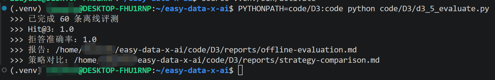

# 2026-11-17 打卡（Task 1：环境准备与课前导读）

## 学习 / 实践内容

### 一、环境准备

今天先把仓库和工具链理顺了：

从github源仓库进行fork，并把源仓库配置成 `upstream`，以后可以定期同步课程更新，然后新建了 `checkin` 分支和 `check-node/` 目录，专门放自己的打卡记录，避免和课程代码混在一起。我按照教程跑了一遍环境都能正常导入，按 README 跑了一遍 D3 的离线评测：60 条案例全部执行，Hit@3 和拒答准确率都是 1.0，说明 Python 环境和示例代码是通的

### 二、F0：OpenClaw 养虾流

26年初，OpenClaw 横空出世，那时候开始流行养虾，我也是第一批开始跟着养虾的人，算是经验丰富了吧。
为此还专门买了一台云服务器，将龙虾养在云端，接入了飞书、钉钉，后面也开了微信，平时记录自己的一些心得想法啊，管理我的项目等等，真的还挺方便的。

我最有共鸣的一句话是：**代码框架决定了它能做什么，数据决定了它做得多好。** 两个人用同样版本的 OpenClaw、同样的模型，体验可能差很多，差别就在各自 workspace 里积累了什么。

### 三、F1：大模型的本质与边界

F1 把大模型的问题归结为三个：**幻觉、知识截止、个性化盲区**。

- 幻觉：回答听起来合理，但事实是编的
- 知识截止：训练数据之后发生的事情它不知道
- 个性化盲区：它知道公共知识，但不知道你的公司、你的用户、你的业务

表面上是三个问题，根因是同一个：**大模型只有训练数据，没有你的数据。** 所以“换个更好的模型”往往不是解法，正确的方向是“补上缺失的数据”：

- 缺可验证的事实 → 做 RAG，把知识库检索进上下文
- 缺实时信息 → 接实时数据源
- 缺用户/业务数据 → 做记忆系统，积累用户画像和偏好

这一节还讲了一个我原来容易忽略的点：**上下文窗口再大，它也是一次性的。** 每次新对话窗口都会清空，模型本身没有地方存“上次聊过什么”。所以 RAG、Memory、Agent 架构，本质上都是在模型之外补一套数据系统。

我也用课里的三个问题复盘了自己以前用 AI 的经历：
最近回答不好的问题，应该是数据的问题，因为我用的claude-opus-5.5，这个模型算是比较好的了，但是测试了好几种方法，上限都是数据的问题，质量不是很高，标签也不是金标，所以想做出一个成果出来真挺难的

### 四、F2：AI Agent 全景图

F2 给了一张很有用的地图。Agent 不是“更聪明的 ChatGPT”，而是具有 **感知 → 推理 → 行动** 循环的系统。经典架构里有四个组件：LLM、Memory、Planning、Tool Use；行业里 80%–90% 的 Agent 用的是 ReAct 架构，剩下 10%–20% 是更可控的流程编排。

课程把公式扩展成了：

> **AI Agent 的能力上限 = 模型能力 × 数据质量 + 流程编排**

乘号决定基础量级，加号只是在基础之上的优化。流程编排解决“怎么走”，Data × LLM 解决“能走多远”。

我之前学 Agent 的时候，用得最广的公式是：Agent = LLM + harness，其实我觉得这些公式都没问题，可能侧重点不一样吧。

F2 还做了一件我很喜欢的事：把 RAG、MCP、Skill、Memory 这四个热词放回同一张地图，然后拆到数据层：

| 能力 | 表面概念 | 数据本质 |
| --- | --- | --- |
| RAG | 检索外部知识 | 知识数据的检索 |
| MCP | 标准化工具接入 | 数据接入的标准化 |
| Skill | 调用结构化技能 | 经验数据的结构化 |
| Memory | 记住与学习 | 数据的积累与召回 |

拆到底，Agent 的每一项能力都是在做数据的存储、检索和流转。

## 五、遇到的问题与解决

- 打卡时间表图片里，Task 2 的 D1 标题和 Task 9 的 P5 标题与仓库实际课程目录不一致。我让AI按仓库目录做了修正，避免后面按错误标题找课程。
- 本地 `_template.md` 我按自己的习惯微调了一下，打卡统一用“日期 + Task 标题 — 学习/实践内容（分小节）— 遇到的问题与解决”的结构。
